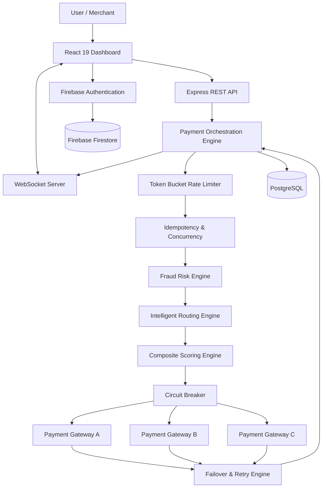
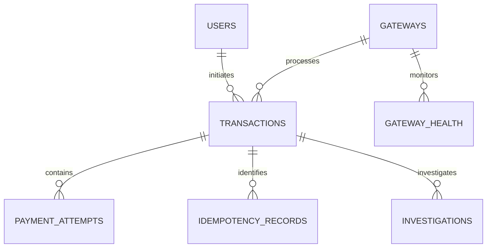

# PayMatrix-Intelligent-Payment-Orchestration-Engine
PayMatrix — Intelligent Payment Orchestration Engine


PayMatrix
Software Engineering Project

Intelligent Payment Orchestration & Reliability Platform

A fault-tolerant payment orchestration platform designed to intelligently route transactions, manage multiple payment gateways, detect suspicious activity, prevent duplicate payments, and maintain payment reliability through automated failover and real-time monitoring.
React 19
Node.js
Express.js
PostgreSQL
WebSockets
Firebase
Drizzle ORM


# PayMatrix – Intelligent Payment Orchestration & Reliability Platform

**A Scalable, Fault-Tolerant Payment Infrastructure for Intelligent Transaction Routing, Fraud Risk Analysis, Automated Failover, and Real-Time Payment Observability.**

[](https://react.dev/)
[](https://nodejs.org/)
[](https://expressjs.com/)
[](https://www.postgresql.org/)
[](https://www.typescriptlang.org/)
[](https://firebase.google.com/)
[]()
[](LICENSE)

---

## 1. Project Overview

PayMatrix is an intelligent payment orchestration and transaction reliability platform designed to simplify and optimize complex payment processing workflows.

Modern payment systems often interact with multiple payment service providers, each having different processing speeds, transaction costs, availability levels, failure rates, and operational requirements.

PayMatrix addresses these challenges through a centralized orchestration engine that evaluates transaction conditions and selects appropriate payment routes using configurable routing strategies.

The platform combines backend engineering, database management, real-time communication, fraud risk evaluation, transaction lifecycle management, and system observability into one unified architecture.

### Core Engineering Objectives

- Intelligent multi-gateway payment routing.
- Reliable transaction processing and state management.
- Duplicate transaction prevention through idempotency.
- Automated gateway failover and recovery.
- Fraud risk evaluation and conditional transaction handling.
- Rate limiting and concurrency management.
- Real-time transaction monitoring.
- Operational visibility through a centralized dashboard.
- Persistent relational and user-specific data management.
- Modular architecture designed for maintainability and extension.

### Project Vision

To demonstrate how modern payment infrastructure can be engineered using reliable backend services, intelligent decision-making, fault-tolerant execution mechanisms, and real-time system monitoring.

---

## 2. Key Features

### 2.1 Intelligent Payment Orchestration

The orchestration engine acts as the central decision-making layer.

It evaluates transaction parameters and available gateway conditions before selecting a suitable payment provider.

Routing considerations include:

- Gateway availability.
- Transaction success and failure rates.
- Gateway performance.
- Configured routing priorities.
- Transaction-specific conditions.
- Risk evaluation results.
- Gateway health and circuit-breaker state.

### 2.2 Multi-Gateway Architecture

PayMatrix supports a modular gateway integration model.

Each gateway can be represented through a standardized interface, allowing the orchestration engine to interact with multiple payment providers without coupling business logic to a specific provider.

Key capabilities:

- Gateway registration and configuration.
- Gateway health monitoring.
- Gateway-specific routing rules.
- Provider-level transaction execution.
- Automatic failover.
- Gateway performance tracking.
- Sandbox gateway simulation.

### 2.3 Idempotency & Duplicate Transaction Prevention

Duplicate payment requests are a major reliability challenge in distributed payment systems.

PayMatrix implements a layered idempotency mechanism to help prevent repeated transaction execution.

The architecture includes:

1. Idempotency key validation.
2. Request-level duplicate detection.
3. Concurrent request coalescing.
4. Transaction state verification.
5. Reuse of previously recorded transaction results.

This helps ensure that repeated requests with the same idempotency identity do not unnecessarily trigger multiple payment attempts.

### 2.4 Fraud Risk Evaluation

The fraud evaluation engine analyzes transaction attributes before routing decisions are finalized.

Potential evaluation parameters include:

- Transaction amount.
- Request frequency.
- User or account activity.
- Transaction metadata.
- Configured risk conditions.
- Suspicious request patterns.

The risk engine can categorize transactions into different risk levels and apply configurable handling rules.

**Important:** Risk scoring is a decision-support mechanism, not a guarantee of fraud detection.

### 2.5 Automated Gateway Failover

Payment providers can experience temporary outages, timeouts, or degraded performance.

PayMatrix incorporates reliability mechanisms to handle gateway failures.

Features include:

- Failure tracking.
- Automatic retry evaluation.
- Alternative gateway selection.
- Gateway health assessment.
- Circuit-breaker protection.
- Recovery testing through HALF_OPEN states.

### 2.6 Circuit Breaker Pattern

The circuit breaker protects the orchestration system from repeatedly sending requests to unhealthy gateways.

Supported operational states:

| State | Purpose |
|---|---|
| CLOSED | Gateway requests are allowed. |
| OPEN | Requests are temporarily blocked. |
| HALF_OPEN | Limited recovery requests are evaluated. |

The system evaluates configurable failure thresholds and gateway error rates.

A 30-second HALF_OPEN recovery interval is used where configured.

### 2.7 Rate Limiting & Traffic Management

The platform incorporates token-bucket rate-limiting mechanics to control incoming request traffic.

Benefits:

- Controls excessive request frequency.
- Protects backend resources.
- Reduces unnecessary gateway calls.
- Helps manage traffic bursts.
- Improves service stability.

### 2.8 Real-Time Monitoring

WebSocket communication provides real-time operational updates to the frontend.

The control plane is designed to display:

- Transaction activity.
- Gateway status.
- Processing results.
- Failure information.
- System events.
- Operational metrics.

### 2.9 Payment Analytics Dashboard

The React-based dashboard provides a centralized interface for observing payment operations.

Dashboard capabilities include:

- Transaction overview.
- Payment success and failure monitoring.
- Gateway performance visualization.
- Transaction investigation views.
- Routing configuration.
- Operational analytics.

Recharts is used for data visualization.

---

## 3. Technology Stack

| Layer | Technology | Responsibility |
|---|---|---|
| Frontend | React 19 | User interface |
| Visualization | Recharts | Analytics and charts |
| Backend | Node.js | Runtime environment |
| API | Express.js | REST API |
| Real-Time | WebSocket | Live system events |
| Database | PostgreSQL | Transactional storage |
| ORM | Drizzle ORM | Database access |
| Authentication | Firebase Auth | User authentication |
| User Data | Firestore | User-specific documents |
| Language | TypeScript | Type-safe development |

### Why These Technologies?

**React 19:** Builds a modular and responsive operational dashboard.

**Node.js and Express:** Provide an event-driven backend and structured API architecture.

**PostgreSQL:** Supports relational data modeling and transactional consistency.

**Drizzle ORM:** Provides type-safe database interaction and schema management.

**Firebase:** Provides authentication and user-specific data capabilities.

**WebSockets:** Enable continuous communication between the backend and dashboard.

---

## 4. System Architecture

PayMatrix follows a modular architecture that separates frontend presentation, API handling, orchestration logic, persistence, and external gateway integrations.

### High-Level Architecture



### Architectural Responsibilities

**Presentation Layer:** Handles user interaction, dashboard rendering, analytics, and real-time updates.

**API Layer:** Validates incoming requests, applies middleware, and forwards business operations to the orchestration engine.

**Orchestration Layer:** Coordinates transaction processing, routing, retries, fraud evaluation, and gateway selection.

**Reliability Layer:** Manages idempotency, rate limiting, gateway health, and circuit-breaker behavior.

**Persistence Layer:** Stores transaction records, gateway configurations, operational data, and user information.

---

## 5. Payment Processing Lifecycle

The payment processing lifecycle is one of the most important parts of PayMatrix.

### End-to-End Transaction Flow

1. A user initiates a payment request.
2. The backend receives the request through the REST API.
3. Authentication and request validation are performed.
4. Rate-limiting rules evaluate request frequency.
5. The idempotency engine checks for duplicate requests.
6. Concurrent requests are evaluated and coalesced where applicable.
7. The fraud risk engine evaluates transaction attributes.
8. The routing engine identifies eligible payment gateways.
9. Composite scoring evaluates configured gateway selection criteria.
10. The circuit breaker verifies gateway health.
11. The selected gateway processes the payment attempt.
12. The transaction result is evaluated.
13. Failed attempts may trigger retry or failover logic.
14. The final transaction state is persisted.
15. WebSocket events communicate relevant updates to the dashboard.
16. The frontend displays the transaction result.

### Transaction State Management

A payment system should explicitly manage transaction lifecycle states.

Example conceptual state model:

```text
CREATED
   |
   v
VALIDATING
   |
   v
ROUTING
   |
   v
PROCESSING
   |
   +------> SUCCEEDED
   |
   +------> FAILED
   |
   +------> RETRYING
   |
   +------> REQUIRES_REVIEW
```

The exact states and permitted transitions should follow the implementation in the backend.

---

## 6. Reliability Engineering

Reliability is a core design objective of PayMatrix.

### 6.1 Idempotent Request Processing

The idempotency layer is designed to protect against repeated payment execution caused by:

- Network interruptions.
- Client retries.
- Duplicate submissions.
- Concurrent requests.
- Uncertain request responses.

### 6.2 Concurrency Coalescing

When multiple requests share the same idempotency identity, the system can coordinate their execution to avoid unnecessary duplicate processing.

### 6.3 Retry Management

Retries should be controlled and evaluated carefully.

The retry mechanism considers:

- Gateway response.
- Failure classification.
- Retry eligibility.
- Maximum configured attempts.
- Gateway health.
- Transaction state.

A retry must not blindly repeat a payment when the original provider response is unknown. Such cases require transaction reconciliation.

### 6.4 Circuit Breaker Recovery

The circuit breaker monitors gateway failures and helps prevent cascading failures.

Its recovery process evaluates whether a previously unhealthy gateway can safely accept new requests.

### 6.5 Transaction Reconciliation

Reconciliation is an important payment infrastructure capability.

The platform's reconciliation components are intended to support the investigation and comparison of internal transaction records against payment provider outcomes.

This helps identify:

- Missing transaction confirmations.
- Inconsistent payment statuses.
- Uncertain payment outcomes.
- Duplicate processing concerns.
- Gateway response discrepancies.

---

## 7. Database Architecture

PayMatrix uses PostgreSQL as its primary relational persistence layer, accessed through Drizzle ORM.

The database schema is defined in:

`src/db/schema.ts`

The relational database is responsible for structured operational data and transaction-related records.

### Database Design Objectives

- Maintain structured relational data.
- Support transaction lifecycle tracking.
- Organize gateway configuration.
- Support routing and operational analytics.
- Maintain consistent relationships.
- Enable efficient database queries.
- Support maintainable schema evolution.

### Relational Data Model

The project schema contains 11 PostgreSQL tables.

The exact table names, columns, indexes, foreign keys, and relationships should be documented directly from `src/db/schema.ts` rather than inferred.

Recommended ER documentation:



*Illustrative relationship diagram. Replace entities and relationships with the actual schema definitions.*

### Firestore Data Organization

Firebase Firestore is used for user-specific document storage.

Conceptual structure:

```text
users/
  {userId}/
    private/
      profile
    presets/
      {presetId}
    investigations/
      {investigationId}
```

Firestore responsibilities include:

- User profile information.
- Personal configuration.
- Saved presets.
- Investigation-related documents.

---

## 8. API Architecture

The backend exposes REST API routes under:

`/api/*`

The WebSocket endpoint is:

`/ws`

### API Design Principles

- Consistent request and response formats.
- Input validation.
- Authentication and authorization.
- Structured error handling.
- Idempotency support for applicable payment operations.
- Clear separation between routes and business logic.
- Controlled database access.

### API Documentation Structure

Document every actual route using the following format:

| Field | Description |
|---|---|
| Method | GET, POST, PUT, PATCH, DELETE |
| Endpoint | Actual route path |
| Purpose | Business operation |
| Authentication | Required or public |
| Request | Expected parameters or body |
| Response | Successful response structure |
| Errors | Possible error conditions |

Example documentation format:

```http
POST /api/payments
Content-Type: application/json
Authorization: Bearer <token>
Idempotency-Key: <unique-key>
```

Example request:

```json
{
  "amount": 1000,
  "currency": "INR",
  "metadata": {
    "orderReference": "ORDER-001"
  }
}
```

*Illustrative API example. Confirm the actual request schema, authentication method, and endpoint before publishing it as a supported route.*

---

## 9. WebSocket Architecture

Endpoint:

`/ws`

WebSockets provide real-time communication between the backend and frontend.

Recommended event documentation:

| Event Category | Purpose |
|---|---|
| Transaction Events | Payment lifecycle updates |
| Gateway Events | Gateway health changes |
| Routing Events | Routing decisions |
| System Events | Operational notifications |
| Investigation Events | Investigation updates |

The actual event names, payload schemas, and subscription rules should be documented from the WebSocket implementation.

---

## 10. Project Directory Structure

The project is organized into modular application layers.

The following is an architectural directory guide. Keep the published tree synchronized with the actual repository.

```text
PayMatrix/
│
├── client/
│   ├── src/
│   │   ├── components/
│   │   │   ├── dashboard/
│   │   │   ├── transactions/
│   │   │   ├── gateways/
│   │   │   └── charts/
│   │   │
│   │   ├── context/
│   │   ├── pages/
│   │   ├── hooks/
│   │   ├── lib/
│   │   └── types/
│   │
│   └── index.html
│
├── src/
│   ├── db/
│   │   ├── schema.ts
│   │   └── index.ts
│   │
│   ├── engine/
│   │   ├── orchestration/
│   │   ├── routing/
│   │   ├── fraud/
│   │   ├── reconciliation/
│   │   ├── idempotency/
│   │   ├── retry/
│   │   └── circuit-breaker/
│   │
│   ├── middleware/
│   │   ├── authentication/
│   │   ├── validation/
│   │   └── rate-limiting/
│   │
│   ├── lib/
│   ├── types/
│   ├── routes/
│   ├── websocket/
│   └── server.ts
│
├── shared/
│
├── migrations/
│
├── scripts/
│
├── tests/
│
├── .env.example
├── .gitignore
├── package.json
├── package-lock.json
├── drizzle.config.ts
├── tsconfig.json
├── README.md
└── LICENSE
```

### Important Modules

**engine/** – Core payment processing and orchestration logic.

**db/** – PostgreSQL connection, schema definitions, and database operations.

**middleware/** – Request authentication, validation, and traffic controls.

**routes/** – REST API endpoint definitions.

**websocket/** – Real-time communication and event handling.

**types/** – Shared TypeScript interfaces and type definitions.

**client/** – React dashboard and frontend components.

---

## 11. Frontend Control Plane

The PayMatrix control plane provides an operational interface for interacting with the payment infrastructure.

### Dashboard Modules

**Overview Dashboard**
- Payment activity.
- Transaction status.
- Gateway health.
- Operational metrics.

**Transaction Management**
- Transaction records.
- Payment outcomes.
- Processing information.
- Investigation workflows.

**Gateway Management**
- Gateway configuration.
- Gateway availability.
- Performance visibility.
- Routing preferences.

**Analytics**
- Transaction trends.
- Payment performance.
- Gateway comparisons.
- Processing outcomes.

**Investigations**
- Transaction examination.
- Failure analysis.
- Risk-related review.
- Operational troubleshooting.

---

## 12. Seeded Sandbox Gateways

PayMatrix includes seeded sandbox gateway configurations for development and testing.

Sandbox gateways can be used to simulate payment processing scenarios without assuming that a live payment provider is connected.

Useful test scenarios include:

- Successful payment.
- Gateway rejection.
- Gateway timeout.
- Temporary service unavailability.
- Retryable failure.
- Circuit-breaker activation.
- Gateway recovery.
- Duplicate request submission.

Sandbox results must not be represented as actual financial transactions.

---

## 13. Security Considerations

Payment infrastructure requires strict security practices.

PayMatrix follows a security-oriented design approach.

### Important Security Controls

- Authentication through Firebase Auth.
- Server-side authorization checks.
- Environment-based secret management.
- Input validation.
- API rate limiting.
- Idempotency validation.
- Secure database access.
- Protection of sensitive transaction information.
- Controlled error responses.
- No hardcoded credentials.

### Production Security Requirements

Before production deployment, the platform should also be evaluated for:

- PCI DSS applicability and compliance requirements.
- Encryption in transit and at rest.
- Secure webhook signature verification.
- Payment data minimization.
- Audit logging.
- Role-based access control.
- Secret rotation.
- Dependency vulnerability scanning.
- Security testing.

PayMatrix should not be considered PCI DSS compliant merely because these security practices are documented.

---

## 14. Environment Variables

Create a local `.env` file using `.env.example` as a template.

Example configuration:

```env
NODE_ENV=development
PORT=3000

DATABASE_URL=

FIREBASE_PROJECT_ID=
FIREBASE_CLIENT_EMAIL=
FIREBASE_PRIVATE_KEY=

CLIENT_ORIGIN=

PAYMENT_GATEWAY_A_API_KEY=
PAYMENT_GATEWAY_B_API_KEY=
```

The variable names above are illustrative. Use the exact variables required by the implementation.

**Never commit `.env` files, private keys, payment credentials, access tokens, or production secrets to GitHub.**

---

## 15. Installation & Local Development

### Prerequisites

- Node.js
- npm
- PostgreSQL
- Firebase project credentials
- Git
- VS Code or another development environment

### Step 1: Clone the Repository

```bash
git clone https://github.com/YOUR_USERNAME/PayMatrix.git
cd PayMatrix
```

### Step 2: Install Dependencies

```bash
npm install
```

### Step 3: Configure Environment Variables

Create `.env` and configure the required environment variables.

### Step 4: Configure PostgreSQL

Create a PostgreSQL database and configure its connection string.

### Step 5: Apply Database Migrations

Use the database migration commands defined in `package.json`.

### Step 6: Configure Firebase

Set up Firebase Authentication and Firestore according to the project's configuration.

### Step 7: Start the Development Server

```bash
npm run dev
```

### Step 8: Open the Application

Open the local development URL displayed in the terminal.

---

## 16. Testing & Reliability Validation

A payment orchestration platform should be validated against both successful and failure scenarios.

### Recommended Test Coverage

| Test Area | Scenario |
|---|---|
| API | Valid and invalid requests |
| Idempotency | Repeated payment requests |
| Concurrency | Simultaneous identical requests |
| Rate Limiting | Excessive request traffic |
| Routing | Gateway selection |
| Failover | Primary gateway failure |
| Circuit Breaker | Gateway outage and recovery |
| Fraud Engine | Configured risk scenarios |
| Database | Persistence and relationships |
| WebSocket | Real-time event delivery |
| Authentication | Authorized and unauthorized access |

### Reliability Goals

- Prevent unintended duplicate execution.
- Maintain clear transaction states.
- Avoid unnecessary requests to unhealthy gateways.
- Recover from temporary gateway failures.
- Maintain observability during processing.
- Handle uncertain payment outcomes safely.

Performance and reliability claims should be supported by reproducible test results and benchmark data.

---

## 17. Scalability & Future Engineering Roadmap

PayMatrix is designed with modular extension opportunities.

### Phase 1 – Core Payment Infrastructure
- Payment orchestration.
- Gateway integration framework.
- Transaction management.
- Routing logic.
- Idempotency.

### Phase 2 – Reliability Engineering
- Advanced retry policies.
- Improved circuit breakers.
- Gateway health analytics.
- Reconciliation improvements.

### Phase 3 – Intelligent Decision Systems
- Adaptive routing strategies.
- Advanced fraud analytics.
- Machine learning-based risk scoring.
- Predictive gateway performance analysis.

### Phase 4 – Distributed Infrastructure
- Message queue integration.
- Event-driven transaction processing.
- Distributed tracing.
- Horizontal service scaling.
- Improved observability.

### Phase 5 – Enterprise Readiness
- Role-based access control.
- Comprehensive audit trails.
- Multi-tenant architecture.
- Advanced security controls.
- Production deployment automation.

These roadmap items represent future development opportunities, not necessarily existing features.

---

## 18. Software Engineering Concepts Demonstrated

PayMatrix demonstrates practical application of several important software engineering concepts:

| Concept | Application |
|---|---|
| System Design | Modular payment architecture |
| Distributed Systems | Gateway communication and failure handling |
| Database Design | Relational PostgreSQL schema |
| API Engineering | Express REST API |
| Concurrency | Request coalescing |
| Idempotency | Duplicate request protection |
| Reliability Engineering | Circuit breakers and retries |
| Rate Limiting | Token-bucket algorithm |
| Event-Driven Systems | WebSocket updates |
| Authentication | Firebase Auth |
| Type Safety | TypeScript |
| Data Visualization | React and Recharts |

This project is particularly relevant to software engineering roles involving backend development, distributed systems, fintech infrastructure, and platform engineering.

---

## 19. Engineering Challenges & Solutions

### Challenge 1: Duplicate Payment Requests

**Problem:** Repeated requests can result in unintended duplicate payment attempts.

**Approach:** Implement idempotency checks and request coalescing.

### Challenge 2: Payment Gateway Failures

**Problem:** An unavailable gateway can interrupt payment processing.

**Approach:** Use gateway health evaluation, retry policies, and circuit-breaker mechanisms.

### Challenge 3: Intelligent Gateway Selection

**Problem:** Different gateways have different performance and availability characteristics.

**Approach:** Use configurable routing conditions and composite scoring.

### Challenge 4: Real-Time Operational Visibility

**Problem:** Traditional request-response communication does not provide continuous dashboard updates.

**Approach:** Integrate WebSocket-based event communication.

### Challenge 5: Transaction Investigation

**Problem:** Payment outcomes can become uncertain when external services fail or responses are delayed.

**Approach:** Maintain transaction records and use reconciliation workflows to investigate inconsistencies.

---

## 20. Why PayMatrix Matters

PayMatrix explores an important engineering problem: how to build payment systems that remain reliable when external services are unpredictable.

The project brings together several backend and infrastructure concepts into one practical application.

Its primary engineering focus includes:

- Reliability over simple request execution.
- Controlled concurrency.
- Safe transaction processing.
- Modular service integration.
- Fault isolation.
- Intelligent routing.
- Operational observability.

The goal is to demonstrate engineering decisions, not simply present a user interface.

---

## 21. Author & Project Information

**Project:** PayMatrix  
**Category:** FinTech / Payment Infrastructure  
**Focus:** Software Engineering, Backend Systems, Distributed Architecture  
**Developer:** Omrita Kumari  
**GitHub:** https://github.com/omritakumari

### Professional Interests

Software Engineering | Backend Development | System Design | Distributed Systems | Artificial Intelligence | FinTech Infrastructure

---

## 22. Disclaimer

PayMatrix is a software engineering project intended for development, experimentation, and demonstration of payment orchestration concepts.

Sandbox gateway configurations are intended for testing. Actual payment processing requires authorized provider integrations, appropriate security controls, regulatory compliance, and production validation.

No real financial transaction should be assumed to have occurred unless a verified payment provider confirms it.

---

## 23. License

This project is distributed under the license specified in the repository's LICENSE file.

---

**PayMatrix – Engineering Reliable Payment Infrastructure.**
